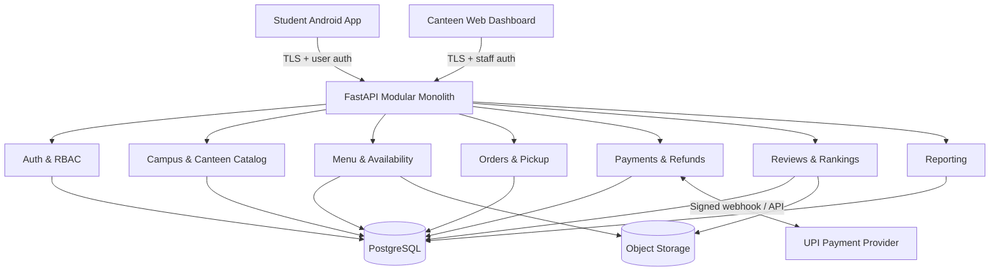

# AISSMS Campus Canteen — Application Architecture

**Version:** 3.0 — adds station-level fulfillment and default menu seed  
**Goals:** Native Android + canteen web, strong payment correctness, modularity, free-first development, modest deployability.

## 1. Recommended stack

| Layer | Choice | Rationale |
|---|---|---|
| Android | Kotlin, Jetpack Compose, Material 3, Navigation, ViewModel, Coroutines/Flow | Native Android APK and maintainable modern UI |
| Admin web | React, TypeScript, Vite, React Router, TanStack Query | Fast responsive dashboard, API-first |
| API | Python FastAPI + Pydantic + SQLAlchemy 2 + Alembic | Typed APIs and approachable modular monolith; alternative NestJS if team prefers full TypeScript |
| Database | PostgreSQL | Relational transactions, uniqueness, row locking, auditability |
| Media | Object storage through an adapter, local filesystem in dev | Uploaded menu/review photos; configurable cloud provider |
| Authentication | Google OpenID Connect for Android users; provisioned staff accounts with Argon2id and secure session tokens | Distinct actor flows |
| Payments | Provider adapter for an RBI/India-compatible UPI merchant gateway | Real payment support while preventing gateway lock-in |
| Development | Docker Compose for PostgreSQL/API, Android Studio, Node.js | Local-first, zero required paid hosting |
| Monitoring | Structured logs, request IDs, healthchecks; optional Sentry-style integration | Debugging, payment diagnostics |
| API contract | OpenAPI schema and client generation/typed DTOs | Consistency across Android/web |

**Decision qualifier:** These are recommendations, not approved implementation technology choices. Review local machine constraints, developer experience and provider availability first.

## 2. System diagram



## 3. Monorepo layout

```text
/
├── AGENTS.md
├── README.md
├── design-references/
│   ├── student-canteen-mockups.jpg
│   └── reviews-mockups.jpg
├── docs/
│   ├── PRODUCT_SPECIFICATION.md
│   ├── APPLICATION_ARCHITECTURE.md
│   ├── api.md
│   ├── database.md
│   ├── decisions.md
│   └── deployment.md
├── apps/
│   ├── android/             # Kotlin/Compose student app
│   └── canteen-web/         # React/TypeScript admin app
├── services/
│   └── api/
│       ├── app/
│       │   ├── core/        # settings, db, security, common errors
│       │   ├── modules/
│       │   │   ├── identity/
│       │   │   ├── campuses/
│       │   │   ├── canteens/
│       │   │   ├── menus/
│       │   │   ├── carts/
│       │   │   ├── orders/
│       │   │   ├── pickup/
│       │   │   ├── payments/
│       │   │   ├── refunds/
│       │   │   ├── reviews/
│       │   │   ├── media/
│       │   │   └── reports/
│       │   └── main.py
│       ├── migrations/
│       └── tests/
├── infra/
│   ├── docker-compose.yml
│   └── deployment/
├── scripts/
└── .env.example
```

Module internals should separate `api/routes`, `schemas`, `application/services`, `domain/models/policies`, `repositories`, and `integrations` as required. Keep modules cohesive rather than forcing unnecessary abstractions.

## 4. Core database design

Core entities and notable fields (illustrative; final SQL migration required):

- `users(id, google_sub, email, display_name, created_at)`
- `staff_users(id, email, password_hash, active, created_at)`
- `staff_memberships(id, staff_user_id, canteen_id, role)`
- `institutes(id, slug, verified_name, branding_asset_id)`
- `canteens(id, institute_id, name, status, timezone, location_description)`
- `canteen_hours(id, canteen_id, day_of_week, opens_at, closes_at, exceptions)`
- `menu_categories(id, canteen_id, name, sort_order)`
- `menu_items(id, canteen_id, category_id, name, description, price_minor, currency, available, archived)`
- `item_media(id, item_id, object_key, ownership, display_order)`
- `carts(id, user_id, canteen_id, state)` and `cart_lines`
- `orders(id, user_id, canteen_id, placed_at, payment_verified_at, cancel_until, fulfillment_state, total_minor, currency)`
- `order_lines(id, order_id, menu_item_id, name_snapshot, unit_price_minor, quantity, line_total_minor)`
- `payments(id, order_id, provider, provider_payment_ref, status, amount_minor, verified_at, idempotency_key)`
- `pickup_credentials(id, order_id, canteen_id, lookup_digest, active, consumed_at)`
- `refunds(id, order_id, payment_id, provider_ref, amount_minor, status, requested_at, completed_at)`
- `reviews(id, user_id, order_line_id, item_id, stars, text, status, created_at)` and `review_media`
- `audit_events(id, actor_type, actor_id, canteen_id, action, target_id, timestamp, metadata)`

Use unique constraints for payment provider IDs, idempotency keys and the chosen active pickup-code namespace. Retain historical order snapshots. Prices in paise (integer minor units); display ₹ formatting only on clients.

## 5. Domain boundaries and key invariants

1. `Canteens`: tenant ownership; API guards enforce membership.
2. `Menus`: admin changes; availability and price checks on checkout.
3. `Orders`: state transition authority and transactional writes; no frontend authority for statuses.
4. `Payments`: gateway integration, verified webhook, reconciliation and payment IDs; payment success is server-derived.
5. `Pickup`: secure active-code lookup and atomic collection, never timestamp-based code expiration.
6. `Refunds`: only cancel-eligible orders, gateway-confirmed outcome and independent status tracking.
7. `Reviews`: eligibility from collected order lines, photo handling, score aggregation.
8. `Reports`: reads transaction snapshots and derives gross/refund/net metrics; clearly define whether totals mean placed, paid or collected.

## 6. Critical transactional flows

### Verified payment

1. Backend checks menu items, canteen hours, server-side totals and creates `PAYMENT_PENDING` order.
2. Backend creates gateway order using an idempotency key.
3. Student authorizes payment in gateway-controlled UPI flow.
4. Provider webhook/API signature is verified; process each provider event exactly once semantically.
5. In one database transaction, transition successful order to `PAID_ACTIVE`, set `payment_verified_at`, compute `cancel_until`, and issue safe code.
6. Notify active canteen queue; student can recover the order after a connection loss.

### Cancellation

`POST /orders/{id}/cancel` authenticated student: transactional check `owner == user`, `state == PAID_ACTIVE`, `now < cancel_until`; set `CANCELLED`, deactivate pickup credential, record refund request intent, enqueue provider refund safely; publish active-order list update.

### Collection

Lookup returns a *preview* restricted to authorized canteen staff. `POST /canteen/orders/{id}/complete` checks `PAID_ACTIVE`, code redemption proof, and staff's canteen membership in a transaction; updates state `COLLECTED`, marks credential consumed. Double submit and races cannot collect twice.

### Refund

Authorized canteen staff initiate eligible refund, backend requests provider refund idempotently, receives async status; show `REFUND_PROCESSING` until provider confirms. Retry safely; audit actions.

## 7. API examples (indicative only)

- `POST /auth/google/exchange`, `POST /auth/staff/login`, `POST /auth/logout`
- `GET /canteens`, `GET /canteens/{id}`, `GET /canteens/{id}/menu`
- `GET /menu-items/{id}`, `GET /menu-items/{id}/reviews`
- `POST /checkout`, `POST /payments/{payment_id}/verify`, `POST /webhooks/payments/{provider}`
- `GET /me/orders`, `GET /me/orders/{id}`, `POST /me/orders/{id}/cancel`
- `GET /staff/orders/active`, `POST /staff/pickup/lookup`, `POST /staff/orders/{id}/complete`
- `GET /staff/menu`, `POST /staff/menu-items`, `PATCH /staff/menu-items/{id}`
- `GET /staff/refunds`, `POST /staff/refunds/{id}/initiate`, `GET /staff/reports/sales`
- `POST /orders/{id}/lines/{line_id}/review`, `PATCH /reviews/{id}`, `POST /media/uploads`

Use versioning (`/api/v1`) and generated OpenAPI documentation. Do not treat these URL names as immovable until API planning is finalized.

## 8. Security, privacy and abuse safeguards

- Android Google identity token must be validated by backend; separate app client IDs and token audiences correctly.
- Provision staff accounts; Argon2id hashes; rotating short-lived access tokens with durable revocable device sessions; least-privilege membership and audited actions.
- Store secrets only in environment/secret management; no embedded gateway credentials in APK or browser.
- Payment webhook signatures, amount/currency verification and replay safety.
- Six-digit codes have low entropy: rate-limit guesses, throttle IP/staff identities, scope lookup and audit attempts. Avoid returning full order details to invalid users.
- Private object storage for reviews until moderation/storage policy permits publication; signed upload URLs if appropriate.
- Minimize PII, define retention, privacy policy, deletion procedures and controlled access logs.
- Normalize and validate all user-supplied inputs; defend against broken tenant-level object authorization.
- HTTPS, CORS allowlist, CSRF/session protections as applicable, SQL injection protection, dependency audit.

## 9. Real-time and offline handling

Start with controlled polling/refetch for active canteen orders and student statuses. Add WebSocket/SSE only if operational testing shows need. Critical logic must remain correct without live updates. Android can cache non-sensitive menu imagery and last-seen history but must not allow offline payment confirmation or offline pickup redemption.

## 10. Deployment strategy and money

**Local / zero-cost:** API+Postgres in Docker Compose; Vite web local; Android emulator/device; fake/sandbox gateway for integration tests. Media saved locally only for development.

**Staging:** use sandbox merchant keys, publicly reachable HTTPS webhook endpoint, test PostgreSQL and test storage; evaluate current free tiers without assuming permanency.

**Production:** only after participating canteens, merchant settlement ownership, KYC, refund authorities and college approvals are resolved. HTTPS domains, secrets management, managed backups, monitoring and object storage require budgeting. Real UPI gateway fees and operational services may be nonzero. Do not promise zero-cost production.

## 11. Automated testing gates

- Unit: pricing, availability, cancellation boundary, review eligibility, rankings.
- API integration: login/permissions, order and refund transitions, webhook handling, cross-canteen isolation.
- Concurrency: double webhook, duplicate code entry, staff double-completion, cancellation-vs-collection races.
- End-to-end: Android ordering with sandbox gateway; web admin menu changes, pickup, refunds.
- Security: pickup brute-force throttling, access control, image-type restriction, credential exposure checks.
- Quality: Kotlin/TypeScript/Python lint, static type checks, migration tests, environment configuration checks.

## 12. Implementation phases and exit criteria

| Phase | Implementation | Exit criteria |
|---|---|---|
| 0 | Lock open decisions and choose tech/provider | Decisions logged; plan approved |
| 1 | Monorepo, DB migrations, auth, tenancy | Both actors log in; isolation tests pass |
| 2 | Canteen discovery, menus, stock toggles | Android shows correct live menu; admin updates reflected |
| 3 | Cart and order draft | Server-total calculation; one-canteen restriction |
| 4 | Gateway sandbox + paid lifecycle | Verified payment creates one active order/code; duplicate webhook harmless |
| 5 | Cancellation, refunds, pickup | Five-minute boundary, concurrency and replay tests pass |
| 6 | Reviews, photos, rankings | Verified only; secure uploads; correct weighted Top 5 |
| 7 | Receipts, reports, UI polish | Accurate reconciliation & mockup parity |
| 8 | Security, deployment, APK & release validation | Launch checklist and payment partner approvals completed |

## 13. Open architecture decisions

Confirm: payment gateway and who owns merchant accounts; settlement model per canteen; permissions for refund initiation; operational policy for uncollected orders at closing; notification channel; moderation; data retention; resource availability in team's dev machines; institutional image/logo permissions; final stack approval.


---

## Approved architecture and implementation amendments — 14 Oct 2026

The owner approved **Kotlin/Jetpack Compose** Android, **React/TypeScript/Vite** admin web, **FastAPI modular monolith**, **PostgreSQL**, provider adapters, and free-first development. This supersedes older 'proposed only' language above. Refer to `DECISIONS.md` for complete final product decisions.

### Domain model additions

- `student_preferences(selected_institute_id)` with a cross-institute account-wide order list; `in_app_notifications` read/unread and event references. No push-token subsystem in MVP.
- `canteen_auth_accounts` support one shared provisioned staff login per canteen initially, canteen separation, server session audit and future individual user migration.
- `merchant_account_configs(canteen_id, provider, provider_account_ref, display_name, status, effective_at, configured_by, changed_at, verified_at)` and a secure secret reference, never plaintext credentials returned by API. Keep historical transaction-to-merchant mapping immutable. Config changes staged, validated with gateway, audited and activated only after provider-approved verification.
- `payment_attempts` and `refund_attempts` permanently reference the merchant configuration/version actually used. Never reroute an already-captured payment or its refund after configuration changes.
- `order_exceptions`, `order_contact_notes` for manual stock/closing resolution, explicit customer consent evidence, staff action and approved financial adjustment.
- `review_reports` unique per (review, reporting account) with reason/time; `review_moderation` status & decision log; hide on configurable distinct valid reports (provisional 3). Provide abuse defenses.
- `activity_audit` log actions with actor account, session/device context, canteen, timestamp and action for shared-account accountability limits.
- Item-wise sales should be calculated from immutable order lines and refunds; define gross/net handling clearly (no duplicate counting refunded transactions).

### API/UI behavior deltas

1. Institute picker appears before canteen discovery and remembers choice; students may switch without losing orders.
2. Closed canteens display menu but checkout is blocked on the server.
3. Notification center is in-app and persists payment/refund/order changes, without push services.
4. Payment retry has pending/failed states and server reconciliation, idempotency keys and correct merchant-account selection.
5. Pickup code is shown as six digits only; code remains active until cancellation/collection without TTL.
6. Staff dashboard supports mobile widths, live queue updates and an optional short sound where browser permits playback.
7. Review gallery and report flow; automatic temporary hide on configurable report threshold with moderator re-review.
8. Reports support daily/weekly/monthly periods, date filters, per-item sold totals, gross/refunds/net.
9. Student receipt stays in-app; no PDF export work in MVP.
10. Staff manually contact students after stock/closing exceptions; record consent and adjustment safely, do not silently mutate paid order totals.

### Operational and CI policy

Use official remote `https://github.com/vighneshvijayjadhav-eng/CAMPUS_CANTEEN.git` with direct incremental verified commits to `main` as instructed by owner. Before each push, pull/reconcile latest remote changes, run relevant gates and never use force push. Continue development phases without routine approval gates, but **do not** activate real-money gateway, change live merchant payout accounts, publish production deployment, or perform irreversible operations without explicit access and authorization. Missing production merchant KYC/credentials are a deployment blocker, not a reason to stop unrelated engineering.


---

# AUTHORITATIVE REVISION — 18 OCT 2026: MULTI-COUNTER PRODUCTION MODEL

This section overrides any older wording that suggests one pickup confirmation completes the entire multi-station order, that there are only two canteen logins, or that pickup tokens expire after a duration. Read `docs/MULTI_COUNTER_WORKFLOW.md` and `docs/MENU_SEED_GUIDE.md`.

- **Objective: a production-grade build**, not a simulated demo. Complete end-to-end implementation, test suites, staging/deployment runbooks and production readiness gates. Never represent sandbox credentials as a live system. Public production rollout and real-money collection require merchant onboarding, institutional/canteen approval, and explicit operational authorization.
- **One canteen, multiple stations.** COE and IOIT remain isolated canteen tenants. Within each canteen create configurable stations (e.g., snacks, juice, meals). Counter identity and food category are distinct. Each menu item/variant must resolve to a station for fulfillment; missing assignments block ordering until mapped. Staff may change mappings via dashboard.
- **One order, one payment, one six-digit code.** Student checks out once per canteen. Persist station-specific fulfillment lines/groupings under a parent order. Fan out its paid order lines to station queues. Same six-digit code can be entered at any authorized counter.
- **Station authorization.** Separate provisioned logins for main admin and each station, using the same sign-in screen; device sessions persist across restarts and can be revoked/rotated. Do not implement literal lifetime unrevocable credentials or publicly shared admin passwords. Station operators view their assigned queue and can complete only their own uncollected lines. Main admin can view/verify all and confirm specific items actually handed over (not merely previewed). Staff can coordinate physical handover verbally as today.
- **Partial pickup.** Code lookup is read-only. Confirmation records specific eligible lines/quantities as handed over, with actor/device/time audit. Never silently mark another station's items complete. Order status becomes COLLECTED only when **all** paid, non-cancelled items are fulfilled; until then display PARTIALLY_COLLECTED and pending stations/items in student app and admin UI. Invalidate code only after full collection or a qualifying whole-order cancellation; prevent replay/double-collection under simultaneous devices.
- **Cancellation:** preserve owner five-minute post-payment cancellation window; once any line has been handed over, whole-order cancellation and refund must not automatically proceed because goods cannot be recalled. Present an exception state for authorized staff resolution and applicable partial refund. Define and test policy explicitly before implementing that edge; do not silently refund an already handed-over item. Within window, cancellation removes unfulfilled station work atomically.
- **Counter notifications:** station dashboards receive scoped real-time paid order/cancel updates, with optional sound after browser user interaction. Main admin sees all. Dashboard requires reconnect/poll fallback and duplicate-event protection.
- **Menu source:** `data/AISSMS_Canteen_Menu.xlsx` is the authoritative initial **IOIT and COE** seed source. `data/menu_seed_draft.json` is a convenience transcription only. IOIT and COE are separate seed targets. COE price/size variations must be preserved; unknown entries flagged for staff verification, never silently estimated. All items initially non-orderable until prices, station assignments, and operating status are confirmed. Continue using dashboard CRUD; **no Excel import UI** requested. Seed script must be idempotent and never overwrite canteen edits on re-run.
- **Deferred:** walk-in cash/UPI POS/billing, ERP, receipt printers. Existing over-the-counter payments continue outside app; do not record offline walk-in payments as gateway-verified app payments.
- **GitHub:** use only `https://github.com/vighneshvijayjadhav-eng/CAMPUS_CANTEEN.git`, commit/push verified phases directly to `main` as requested; avoid force pushes, reconcile remote changes, never store secrets. Continue coding across phases without routine approval requests; report real tests and blocked external dependencies.
